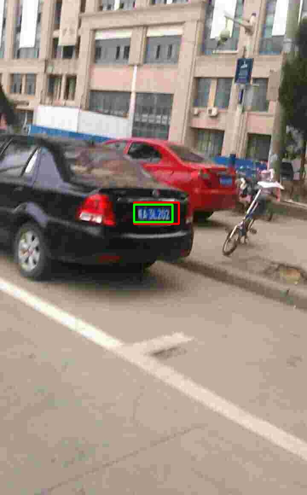

# Chinese License Plate Detection and Recognition

[简体中文](README.zh-CN.md) · [Getting started](docs/getting_started.md) · [Python API](docs/python_api.md) · [Evaluation](docs/evaluation.md)

Detect a Chinese license plate with **YOLOv8n** and recognise its seven characters with a **seven-head residual CNN**. [Trained checkpoints](docs/models.md) are included: inference on your own images does **not** require downloading the CCPD dataset.

Original course project by **Haoqing Gu, Junwen Xue, Zezheng Yu, Ye Li and Xiaoyang Chen**. The report uses conference-style formatting and is not a claim of IEEE publication.



## Quick start

Requires **Python 3.10–3.12**. Run the following in a terminal:

```bash
git clone https://github.com/Echo20010723/chinese-license-plate-recognition.git
cd chinese-license-plate-recognition
python -m venv .venv
```

Activate the environment:

```powershell
# Windows PowerShell
.\.venv\Scripts\Activate.ps1
```

```bash
# macOS / Linux
source .venv/bin/activate
```

Install and run the bundled example:

```bash
python -m pip install -r requirements.txt
python predict.py --image detection/results/prediction_gallery/base.jpg --output outputs/example.json
```

The bundled example is an annotated experiment image, useful for checking installation. To recognise your own image:

```bash
python predict.py --image path/to/car.jpg --device cpu --output outputs/my_plate.json
```

The UTF-8 JSON contains `detected`, `bbox`, `detector_confidence` and `recognition` (Chinese text, class indices and character confidences). If no plate passes the threshold, `detected` is `false` and the remaining prediction fields are `null`. Outputs go to `outputs/` and are not tracked by Git.

For CUDA, install the appropriate PyTorch build first and use `--device cuda:0`. See [installation and troubleshooting](docs/getting_started.md) for details and an illustrative output.

## Use in your application

Run from the repository root. Reuse one instance to avoid loading weights for each image:

```python
from pipeline import PlateRecognizer

reader = PlateRecognizer(device="cpu")
result = reader.predict("path/to/car.jpg")
if result["detected"]:
    print(result["recognition"]["text"])
```

See [Python API](docs/python_api.md) for parameters, errors, output fields and repeated calls.

## Project map

| Path | Purpose |
| --- | --- |
| `predict.py` | Single-image command-line entry point |
| `pipeline/inference.py` | Reusable detection + recognition API |
| `recognition/model.py`, `recognition/inference.py` | CNN architecture and crop preprocessing |
| `ccpd_annotations.py` | CCPD filename annotation parser and character tables |
| `config.py` | Dataset discovery and experiment constants |
| `notebooks/ccpd_workflow.ipynb` | Full original data, training and evaluation workflow |
| `detection/` | Detector preparation, training, evaluation, weights and recorded results |
| `recognition/checkpoints/` | Trained recogniser: `seven_head_ccpd2019.pt` |
| `data_preparation/` | Fixed split lists and selected-image metadata |
| `pipeline/results/` | Recorded combined predictions and error analysis |
| `docs/project_overview.html`, `docs/project_report.pdf` | Visual results overview and original report |
| `validate_results.py`, `tests/` | Saved-result validation and automated tests |

Use `python predict.py --help` to discover inference options. Use [reproduction instructions](docs/reproduce_experiments.md) for training and evaluation. Existing experiment filenames retain their seed/run provenance.

## Recorded experiment results

The CCPD2019 experiment uses 30,000 training, 5,000 validation and 10,000 test images (seed 9444), rather than the complete benchmark.

| Metric | Recorded result |
| --- | --- |
| Base detector mAP@0.5 | 99.5% |
| Base detector localisation, IoU > 0.7 | 99.2% |
| Overall detector localisation, IoU > 0.7 | 90.52% |
| Overall pipeline exact-plate accuracy | 70.41% |
| Overall strict pipeline accuracy | 66.35% |
| Pipeline throughput, RTX 3060 Laptop GPU | 47.22 FPS |

These are saved group experiment results, not new measurements from the CLI. Detector-only and combined evaluations use different confidence/timing protocols; see [metric definitions](docs/evaluation.md). Blur, lighting and perspective remain limitations.

The pipeline selects **one highest-confidence plate** and the recogniser supports **seven-character Chinese plates only**. CCPD-Green data preparation supports detection experiments; the included recogniser does not support eight-character new-energy plates. Confidence scores are not calibrated correctness probabilities.

## Development

```bash
python -m pip install -r requirements-dev.txt
python -m pytest -q
python validate_results.py
```

Saved-result validation uses only the standard library. CI checks Python 3.10 and 3.12 without raw datasets or retraining. See [CONTRIBUTING.md](CONTRIBUTING.md), [validation record](docs/validation.md) and [filename migration](docs/file_naming.md).

## Attribution and distribution

Raw datasets, local environments and generated outputs are excluded. Obtain CCPD separately from the [original dataset project](https://github.com/detectRecog/CCPD) for reproduction. Weights, split lists, recorded results and the team report are retained.

The project preserves all five original authors. Public availability does not add a new project-wide license grant; upstream code, weights and datasets retain their own terms. See [THIRD_PARTY_NOTICES.md](THIRD_PARTY_NOTICES.md).
